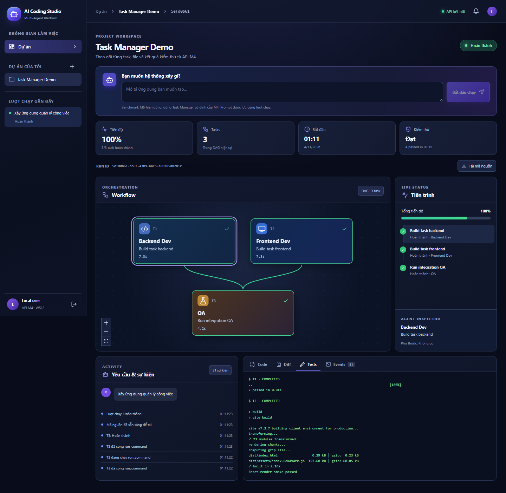
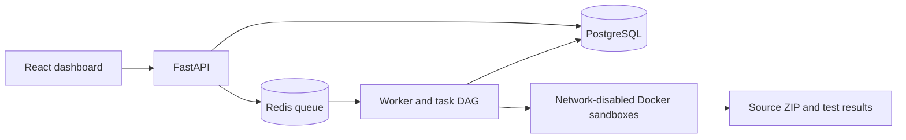

# Multi-Agent AI Coding Platform

[](https://github.com/nqkhanh298/multi-agent-manager/actions/workflows/ci.yml)
[](LICENSE)

A local Codex coding platform prototype with task orchestration, isolated execution, a persistent API, and a live dashboard.

> **Current scope:** Describe the outcome in plain language. Coordinator chooses the needed agents and whether to deliver a browser app, a Python terminal program, or a Markdown research report. The dashboard previews the result. The original fixed Task Manager demo remains available through the legacy API. Native desktop packaging, backend services, and arbitrary stacks remain future work. Codex account sign-in and live generation require a user's own ChatGPT authorization.



## What is implemented

| Area | Capability |
| --- | --- |
| Agent runtime | Tool-calling adapter, bounded steps, isolated file and command tools |
| Codex agents | Registry of eight specialist roles with separate skills, Codex sessions, and selectable Codex models; Coordinator selects the roles for each prompt |
| Orchestration | Validated task DAG, Coordinator and QA, checkpointing, repair loop |
| Parallel work | Git worktrees for independent tasks, ordered merges, integration QA |
| Platform backend | FastAPI, PostgreSQL, Redis worker, bearer auth, ordered events, WebSocket replay, run controls, source ZIP |
| Dashboard | React, TypeScript, horizontal role-colored React Flow workflow, per-agent activity history, browser, terminal, or report Preview, reference attachments, Monaco, file explorer, Git diff, logs, tests, approvals |
| Hardening | Budgets, worker heartbeat recovery, fault injection, sandbox checks, browser tests |



## Quick start

**Requirements:** Windows 11 with WSL2 Ubuntu and Docker Desktop with WSL integration; Python 3.11+ in Ubuntu; Node.js 22+ and npm for the dashboard. The Codex path also requires the Codex CLI installed inside the same Ubuntu distro as the API and worker. Keep the Python project on the WSL Linux filesystem, such as `~/projects/multi-agent-manager`. Docker must be available from Ubuntu.

In Ubuntu WSL, clone and prepare the backend:

```bash
git clone https://github.com/nqkhanh298/multi-agent-manager.git
cd multi-agent-manager
python3 -m venv .venv
source .venv/bin/activate
python -m pip install -e '.[dev]'
curl -fsSL https://chatgpt.com/codex/install.sh | sh
docker build -f docker/sandbox.Dockerfile -t ai-coding-m1:local .
docker build -f docker/frontend.Dockerfile -t ai-coding-m3-frontend:local .
docker compose -f docker/compose.yaml up -d --wait postgres redis
alembic upgrade head
python -m apps.api.bootstrap --name local
```

Save the API token printed by the last command. It is shown only once. Start the API and worker in **separate Ubuntu terminals** from the repository root, with the virtual environment activated:

```bash
uvicorn apps.api.main:app --host 127.0.0.1 --port 8000
```

```bash
python -m apps.worker.main
```

With Node.js available in WSL or a synchronized Windows checkout, start the dashboard:

```bash
cd apps/web
npm ci
npm run dev
```

Open **http://localhost:5173/** and paste the local platform API token. Connect ChatGPT to Codex in the dashboard; the device-code option is available if the browser callback does not work. Create a project and describe the result you need. Coordinator selects a suitable agent team and one of three outputs: a browser app, a Python terminal program, or a research report. The workflow adds only the selected role blocks after planning. Open **Preview** to use the app or read the report. For terminal programs, enter responses on separate lines and click **Chạy thử**; each click runs the program from the beginning inside Docker. Completed reports can be downloaded as Markdown. The fixed Task Manager benchmark remains accessible with `engine: "demo"` through the API. The API explorer is at **http://localhost:8000/docs**. The platform API token and Codex sign-in are separate credentials.

To assign different Codex models to specialist agents, open **Model Codex theo vai trò**, choose a model for each role, then save before starting a new run. The list comes from Codex. Leave a role at **Mặc định tài khoản** to use the account's default model. The target selector follows Coordinator's model. See [Codex role models](docs/codex-role-models.md).

Attach up to three reference files beside the prompt when you need agents to follow existing requirements or designs. PDF, DOCX, TXT, MD, CSV, and JSON are supported. The dashboard shows the extracted text, delivery events for each agent, and QA's quote-to-output checks. A run with references cannot complete if QA cannot identify a quote from every document and matching evidence in the generated app or report. See [reference handling and limits](docs/references.md).

You can also select a local source folder as a read-only reference for a **new** project. Its supported text files and relative paths are sent to every selected Codex agent; the original project is never used as the output workspace or changed. The dashboard shows the files received and QA evidence linking the reference to the new output. See [source folder limits](docs/references.md#local-source-as-reference).

For smaller offline demonstrations, run `python -m coding_platform.cli demo`, `m2-demo`, or `m3-demo` from the repository root in Ubuntu. The first creates a calculator and runs pytest; M2 demonstrates a failed test followed by repair; M3 builds and merges backend and frontend branches.

To remove an old project, use the trash button beside its name and confirm. This deletes its runs, events, generated files, and artifacts. Cancel or complete every run in the project first; the API rejects deletion while work is active.

## Verification

From Ubuntu WSL:

```bash
ruff check .
ruff format --check .
pytest -q
python -m scripts.verify_m1_sandbox
```

From `apps/web` with Node.js:

```bash
npm run build
npm run test
npm run test:e2e
```

The browser suite runs fifteen API-fixture scenarios. Its optional legacy live demo requires `M5_LIVE_TOKEN` and running API, worker, PostgreSQL, Redis, and Docker services. The M4 integration and M6 worker-kill checks are documented in [the development guide](docs/development-guide.md); stop the persistent worker before either check because they control their own queue worker.

The M7 local checks passed **53 Python tests**, **3 frontend unit tests**, a production dashboard build, and **9 fixture-backed browser tests**. A live eight-role Codex Web smoke run completed with five generated Node tests passing in Docker. See the [M7 report](docs/m7-report.md). The M6 live benchmark and sandbox checks are recorded in the [M6 report](docs/m6-report.md). GitHub Actions runs lint, unit tests, frontend build, and fixture-backed browser tests on each push and pull request.

The automatic Preview changes and current verification are recorded in the [automatic preview report](docs/automatic-preview-report.md).

## Security and limitations

- Generated code runs in Docker with no network, a non-root UID, a read-only root filesystem, limited resources, and a workspace mount. Docker Desktop/WSL2 is suitable for a local demo, not hostile multi-tenant production isolation.
- A crashed worker leaves uncertain tool calls marked `UNKNOWN` and its run `BLOCKED` for manual reconciliation. It does not blindly replay side effects.
- The offline Task Manager demo still uses deterministic agents. The Codex path invokes real role sessions. Coordinator selects a sequential task graph for each new prompt from the eight-role registry. A standalone web app completed a live eight-role smoke run; the new dynamic planner and report route have automated mock-runtime tests but have not yet completed a live Codex smoke run. Codex Web currently produces standalone HTML/CSS/JavaScript without a backend or external dependencies.
- Research roles run without network access. For current facts or source-backed reports, attach reference documents; the report must state when external evidence was unavailable.
- The activity panel records observable Codex tool names, search queries or opened pages when those actions occur, attached reference names, output paths, and readable reasoning summaries when Codex provides them. It does not record raw private reasoning or command output. Older runs can show only the activity events that were captured at the time.
- ChatGPT-plan Codex runs do not expose a USD price to this platform. The dashboard leaves USD budget/spend unset for those runs; the time limit still applies. Usage remains subject to the connected account's plan and limits.
- Codex login is stored per local platform user under ignored `.local/platform/codex-accounts/`. The application never reads or copies the existing Windows Codex `auth.json`. Generated tests run in Docker. A web preview runs JavaScript in a sandboxed, opaque-origin iframe with a restrictive content security policy.
- The editor, diff, and terminal views are read-only. The benchmark does not create approval requests on its own.
- Keep API tokens and model keys out of Git. `.env`, local run data, build output, and editor settings are ignored.

## Repository guide

- [`coding_platform/`](coding_platform/) — agent runtime, planning, sandbox, and M1–M3 orchestration
- [`apps/api/`](apps/api/) and [`apps/worker/`](apps/worker/) — platform API and worker
- [`apps/web/`](apps/web/) — dashboard and browser tests
- [`docker/`](docker/) and [`migrations/`](migrations/) — local infrastructure and schema
- [`docs/development-guide.md`](docs/development-guide.md) — detailed setup and milestone commands
- [`docs/m1-report.md`](docs/m1-report.md) through [`docs/m6-report.md`](docs/m6-report.md) — verification evidence
- [`docs/m7-report.md`](docs/m7-report.md) — Codex role path, verification, and remaining work
- [`MULTI_AGENT_CODING_PLATFORM_WINDOWS.md`](MULTI_AGENT_CODING_PLATFORM_WINDOWS.md) — original project specification

Contributions are welcome; see [CONTRIBUTING.md](CONTRIBUTING.md). Licensed under the [MIT License](LICENSE).
