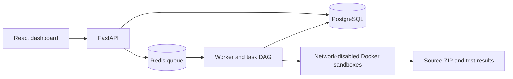

# Multi-Agent AI Coding Platform

[](https://github.com/nqkhanh298/multi-agent-manager/actions/workflows/ci.yml)
[](LICENSE)

A local coding platform prototype with task orchestration, isolated execution, a persistent API, and a live dashboard. It was built and verified across six milestones on Windows 11, Ubuntu WSL2, and Docker Desktop.

> **Current scope:** The platform's API and dashboard show real runs, events, files, tests, and artifacts. The worker currently uses deterministic agents to build a fixed Task Manager example, regardless of the prompt. General prompt-to-app generation is future work.


## What is implemented

| Area | Capability |
| --- | --- |
| Agent runtime | Tool-calling adapter, bounded steps, isolated file and command tools |
| Orchestration | Validated task DAG, Coordinator and QA, checkpointing, repair loop |
| Parallel work | Git worktrees for independent tasks, ordered merges, integration QA |
| Platform backend | FastAPI, PostgreSQL, Redis worker, bearer auth, ordered events, WebSocket replay, run controls, source ZIP |
| Dashboard | React, TypeScript, React Flow, Monaco, file explorer, Git diff, logs, tests, approvals |
| Hardening | Budgets, worker heartbeat recovery, fault injection, sandbox checks, browser tests |



## Quick start

**Requirements:** Windows 11 with WSL2 Ubuntu and Docker Desktop with WSL integration; Python 3.11+ in Ubuntu; Node.js 22+ and npm for the dashboard. Keep the Python project on the WSL Linux filesystem, such as `~/projects/multi-agent-manager`. Docker must be available from Ubuntu.

In Ubuntu WSL, clone and prepare the backend:

```bash
git clone https://github.com/nqkhanh298/multi-agent-manager.git
cd multi-agent-manager
python3 -m venv .venv
source .venv/bin/activate
python -m pip install -e '.[dev]'
docker build -f docker/sandbox.Dockerfile -t ai-coding-m1:local .
docker build -f docker/frontend.Dockerfile -t ai-coding-m3-frontend:local .
docker compose -f docker/compose.yaml up -d --wait postgres redis
alembic upgrade head
python -m apps.api.bootstrap --name local
```

Save the API token printed by the last command. It is shown only once. Start the API and worker in **separate Ubuntu terminals** from the repository root, with the virtual environment activated:

```bash
uvicorn apps.api.main:app --host 127.0.0.1 --port 8000
```

```bash
python -m apps.worker.main
```

With Node.js available in WSL or a synchronized Windows checkout, start the dashboard:

```bash
cd apps/web
npm ci
npm run dev
```

Open **http://localhost:5173/**, paste the API token, create a project, and start a run. The API explorer is at **http://localhost:8000/docs**. The prompt is stored and shown, but the generated application is currently the fixed Task Manager benchmark.

For smaller offline demonstrations, run `python -m coding_platform.cli demo`, `m2-demo`, or `m3-demo` from the repository root in Ubuntu. The first creates a calculator and runs pytest; M2 demonstrates a failed test followed by repair; M3 builds and merges backend and frontend branches.

## Verification

From Ubuntu WSL:

```bash
ruff check .
ruff format --check .
pytest -q
python -m scripts.verify_m1_sandbox
```

From `apps/web` with Node.js:

```bash
npm run build
npm run test
npm run test:e2e
```

The browser suite runs four API-fixture scenarios. Its optional live run requires `M5_LIVE_TOKEN` and running API, worker, PostgreSQL, Redis, and Docker services. The M4 integration and M6 worker-kill checks are documented in [the development guide](docs/development-guide.md); stop the persistent worker before either check because they control their own queue worker.

The latest local verification passed **43 Python tests**, **3 frontend unit tests**, **5 browser tests** including one live run, and seven sandbox security checks. See the [M6 report](docs/m6-report.md) for run IDs, artifacts, and remaining risks. GitHub Actions runs lint, unit tests, frontend build, and fixture-backed browser tests on each push and pull request.

## Security and limitations

- Generated code runs in Docker with no network, a non-root UID, a read-only root filesystem, limited resources, and a workspace mount. Docker Desktop/WSL2 is suitable for a local demo, not hostile multi-tenant production isolation.
- A crashed worker leaves uncertain tool calls marked `UNKNOWN` and its run `BLOCKED` for manual reconciliation. It does not blindly replay side effects.
- The platform worker does not yet call a live model. Optional M1/M2 model adapters exist, but their live paid paths were not part of the verified benchmark. Mock runs correctly report zero model usage and cost.
- The editor, diff, and terminal views are read-only. The benchmark does not create approval requests on its own.
- Keep API tokens and model keys out of Git. `.env`, local run data, build output, and editor settings are ignored.

## Repository guide

- [`coding_platform/`](coding_platform/) — agent runtime, planning, sandbox, and M1–M3 orchestration
- [`apps/api/`](apps/api/) and [`apps/worker/`](apps/worker/) — platform API and worker
- [`apps/web/`](apps/web/) — dashboard and browser tests
- [`docker/`](docker/) and [`migrations/`](migrations/) — local infrastructure and schema
- [`docs/development-guide.md`](docs/development-guide.md) — detailed setup and milestone commands
- [`docs/m1-report.md`](docs/m1-report.md) through [`docs/m6-report.md`](docs/m6-report.md) — verification evidence
- [`MULTI_AGENT_CODING_PLATFORM_WINDOWS.md`](MULTI_AGENT_CODING_PLATFORM_WINDOWS.md) — original project specification

Contributions are welcome; see [CONTRIBUTING.md](CONTRIBUTING.md). Licensed under the [MIT License](LICENSE).
